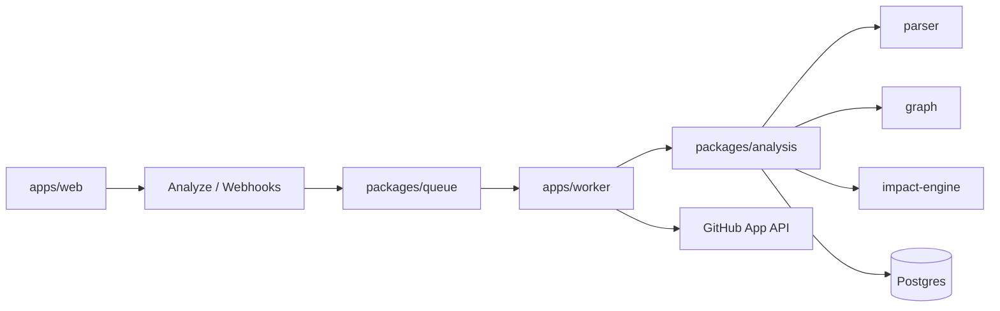

# GitImpact

**Know what breaks before you merge.**

GitImpact estimates the blast radius of code changes with **deterministic static analysis** — dependency graphs, impacted symbols/APIs/tests, and optional GitHub pull-request comments & Check Runs. An optional **Bring Your Own Key (BYOK)** AI layer can narrate those findings; it never replaces the analyzer.

> Accuracy is measured and limited. Heuristic parsers (especially Java / Rust / C#) estimate relationships; they do not prove every runtime consequence of a merge.

## Why it exists

Code review often asks: *what else might this PR touch?* GitImpact clones a repo (or PR), builds a graph of imports/calls/routes/tests, and surfaces likely affected components so you can prioritize review and regression testing.

## Quick start (local)

Requires **Node 20+** and **pnpm 9**.

```bash
pnpm install
pnpm build:packages
pnpm --filter @gitimpact/web dev
```

Open [http://localhost:3000](http://localhost:3000) (use another port if 3000 is taken).

- Paste a **public** GitHub repo or PR URL, or try demos:
  - [/demo/tiny-fixture](http://localhost:3000/demo/tiny-fixture)
  - [/demo/tiny-fixture/pull/1](http://localhost:3000/demo/tiny-fixture/pull/1)
- Offline CLI: `node cli/dist/index.js analyze ./my-checkout`

Optional Postgres (persistence) + Redis (durable queue):

```bash
cp .env.example apps/web/.env.local
pnpm db:up
pnpm db:push
pnpm --filter @gitimpact/web dev
pnpm worker:dev   # when REDIS_URL is set
```

Without `DATABASE_URL`, analyses stay in memory (lost on restart).

## What works today

| Area | Status |
|------|--------|
| Public GitHub repo / PR analyze | Implemented |
| Dependency graph + blast-radius traversal | Implemented |
| PR comment upsert + Check Runs (GitHub App) | Implemented (live private E2E needs App credentials) |
| CLI (`analyze`, `impact`, `history`, `compare`, `export`) | Implemented |
| Languages: JS/TS (AST), Python / Go / Java / Rust / C# (heuristics) | Implemented — depth varies |
| Framework routes (Next, Express, Nest, Flask/FastAPI/Django, Echo/Gin/Chi, Spring/Axum/ASP.NET, …) | Implemented — see dogfood docs |
| Optional BYOK AI narrative | Implemented — opt-in; deterministic path works without AI |
| History, compare, saved views, PR impact sparkline | Implemented (v1.2) |

**Experimental / limited:** Java, Rust, and C# relationship accuracy (dogfood wave 7); AI narratives (interpretations only).

**Planned / blocked for beta tag:** live private-repo App E2E with your credentials — see `docs/release-candidate.md`.

## Deterministic vs AI

```text
clone → parse → graph → impact → persist
                              ↓ optional
                     AI narrates the digest (BYOK or server key for PR comments)
```

- **Deterministic:** symbols, edges, scores, test gaps — source of truth.
- **AI (optional):** explains the digest; must not invent files, bugs, or test results.
- Keys never go on BullMQ job payloads. Details: [`docs/ai.md`](docs/ai.md).

## Architecture (high level)



| Path | Role |
|------|------|
| `apps/web` | Next.js UI + HTTP APIs |
| `apps/worker` | BullMQ / inline job processor |
| `packages/analysis` | Orchestration, PR workflow, coverage |
| `packages/parser` | Language surface extraction |
| `packages/graph` / `impact-engine` | Graph + blast radius |
| `packages/git` | Clone, App auth, comments, checks |
| `packages/ai` | Optional BYOK narratives |
| `cli` | Local adoption without the UI |

## GitHub App

Production PR flow: App install → signed webhook → async job → comment + Check Run.

See [`docs/github-app.md`](docs/github-app.md) and [`docs/private-repo-e2e.md`](docs/private-repo-e2e.md).

Required env (production): `GITHUB_APP_ID`, `GITHUB_APP_PRIVATE_KEY`, `GITHUB_WEBHOOK_SECRET`, `DATABASE_URL`, `REDIS_URL`. Full list: [`.env.example`](.env.example).

## Tests

```bash
pnpm build:packages
pnpm test:accuracy
pnpm test:real-world
pnpm relationships
pnpm rc:no-exec          # proves install scripts are never run on analyzed repos
```

RC helpers (need running web / credentials as noted): `pnpm rc:load-test`, `pnpm rc:private-e2e`.

## Security & privacy

- Repository code is **never executed** (`npm`/`pnpm` scripts, binaries, etc.).
- Only `https://github.com/...` clone URLs; git via `execFile` (no shell).
- Webhook signatures verified; tokens not logged.
- Policy: [`SECURITY.md`](SECURITY.md) · details: [`docs/security.md`](docs/security.md).

## Contributing

See [`CONTRIBUTING.md`](CONTRIBUTING.md) and [`docs/contributing.md`](docs/contributing.md).

Roadmap: [`docs/roadmap.md`](docs/roadmap.md). Changelog: [`CHANGELOG.md`](CHANGELOG.md).

## License

[MIT](LICENSE) © 2026 almightymoon
